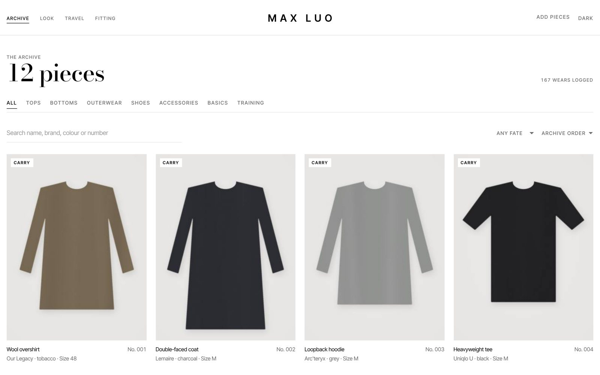
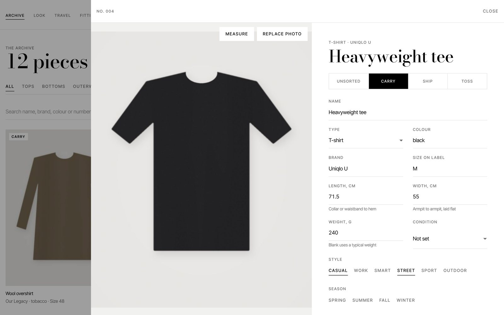
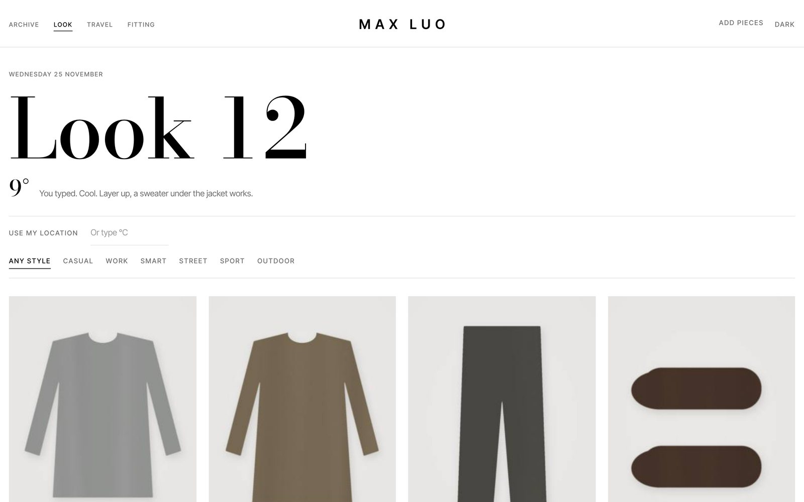
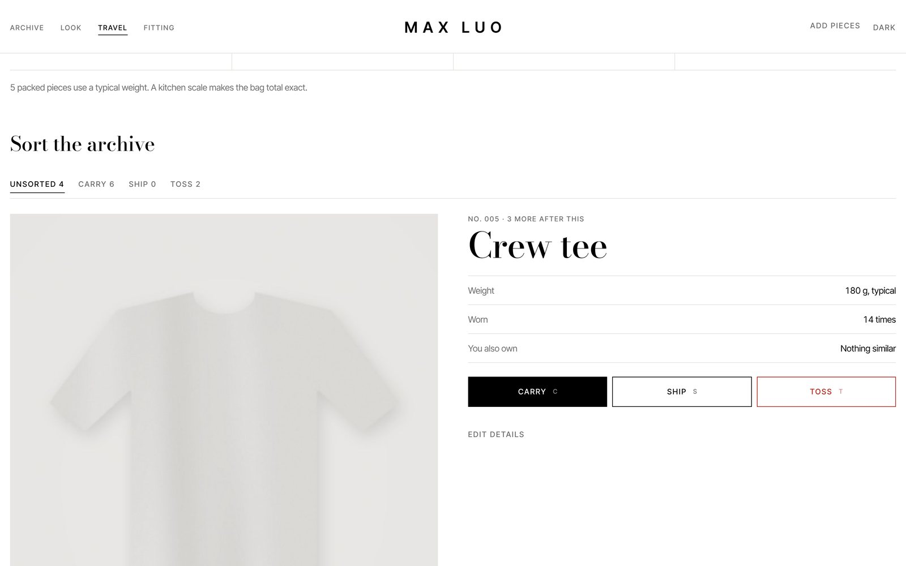
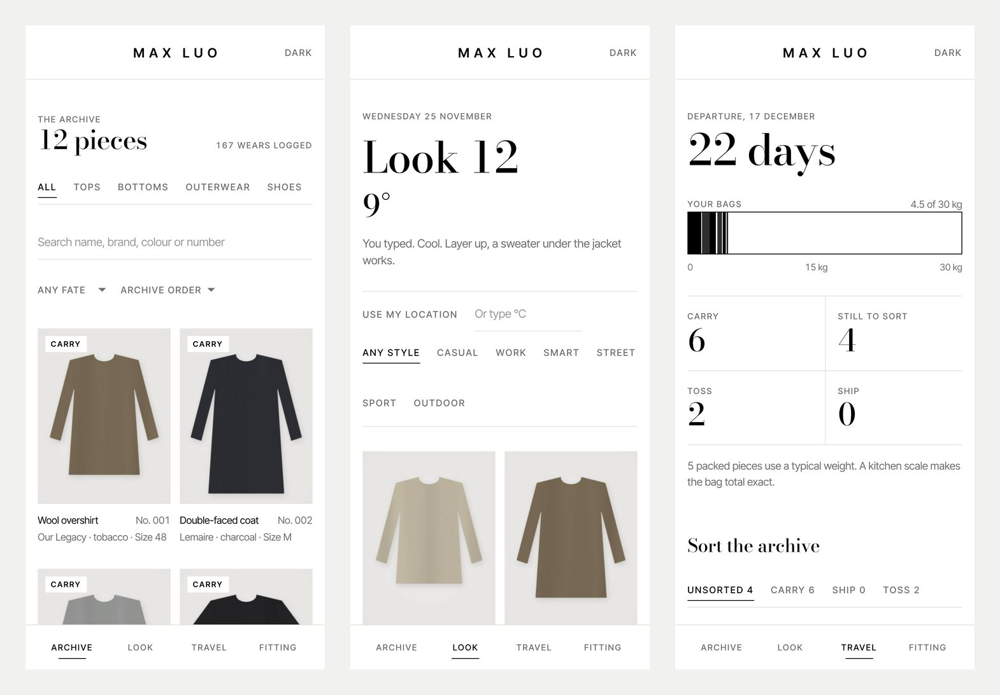

# Capsule

A personal wardrobe archive with a fashion-house feel. Photograph each piece, measure it from the photo, get a daily look picked for the weather, and sort everything into carry, ship or toss before a move.

**Live:** [nyannnnn.github.io/capsule](https://nyannnnn.github.io/capsule/)



## Why I built it

I was moving countries with one checked bag and a closet that didn't fit in it. I wanted to see every piece I own, know what each one weighs and how often I actually wear it, and make the keep-or-toss calls with data instead of guesswork. Then I wanted to keep using it every morning, so it had to look good.

## What it does

| | |
|---|---|
| **Archive** | Every piece gets front and back photos, a number (No. 001, No. 002…), brand, size, colour, style and season tags. Hover a piece to see its back. Filter by type, search by anything, sort by most or least worn. |
| **Palette** | A strip of every piece's dominant colour, sampled from its cutout, sits atop the archive. |
| **Studio cutouts** | Backgrounds are removed in the browser as photos are added, so every piece sits on the same clean backdrop whatever the photo's orientation. The original is kept for measuring. |
| **Batch add** | Shoot each piece front then back, select every photo at once, and they're paired by capture time. |
| **Measure from a photo** | Lay the piece flat beside a credit card, tap the card's two ends, then the garment's length and width. The card's known 85.6 mm edge sets the scale. |
| **Fit check** | Compares flat garment width against your body measurements and calls the fit: slim, regular, relaxed, oversized. |
| **Look** | Picks a top, bottom, shoes and, when it's cold, an outer layer, using the day's temperature, your chosen style and what you haven't worn lately. Shown as an editorial flat-lay; keep the pieces you like, swap the rest, log the look, or save it as a 4:5 image to share. |
| **Travel** | Shows days until departure and a bag bar that fills piece by piece against your allowance. A one-at-a-time sorter shows weight, wear count and look-alikes you already own: swipe the photo right to carry or left to toss, or use C, S, T on a keyboard. Every move can be undone. |
| **Before you buy** | Name a type and colour, and it tells you how many similar pieces you own and how often they actually get worn. |
| **Ask Claude** | Exports the archive as a text summary plus a numbered contact sheet, and parses decisions pasted back ("12 carry, 13 toss") into bulk updates. |









## How it works

**Measuring.** The user taps two points on the reference card and two on the garment. With the card's real length $L_\text{ref}$ and pixel length $d_\text{ref}$, any garment distance is

$$\text{cm} = \frac{d_\text{garment}}{d_\text{ref}} \cdot L_\text{ref}$$

This assumes the card and garment lie in the same plane and the photo is shot straight down, which the app asks for. Points can be dragged after placing them to fine-tune.

**Fit.** For tops, flat pit-to-pit width $w$ doubles to roughly the garment's chest circumference, so ease is $2w - \text{chest}$. Under 2 cm reads as too tight, 8–16 cm as regular, and over 26 cm as oversized. Bottoms use waist with tighter bands.

**Outfit picks.** Each slot is filled by weighted random sampling rather than always taking the top score, so you don't get the same look every day. An item's weight starts from freshness, $1 + \min(\text{days since worn}, 60)/10$, then gets multiplied up for a matching style tag and down for the wrong season or for warm pieces on hot days. A light colour rule keeps at most one non-neutral colour per look.

**Similarity.** Pieces are grouped by category plus a colour family (charcoal and grey both map to grey, khaki and stone to beige), which drives the "you also own" count and the buying check.

**Shipping, in case it's needed.** Japan Post Zone 3 parcel rates for sea, SAL and airmail are built in. Shipments are split into the fewest 30 kg boxes, and the marginal cost per extra kilogram is shown so you can see what one more jacket actually costs.

## Stack

- **Front end:** plain HTML, CSS and JavaScript modules. No framework or build step, so the repo is the site.
- **Data:** [Supabase](https://supabase.com) Postgres plus Storage, on the free tier. Photos are compressed in the browser to about 200 KB each, so 1 GB holds thousands of pieces.
- **Privacy:** row level security in [`schema.sql`](schema.sql) locks every row and photo to its owner. Public sign-ups are switched off, and the anon key in `config.js` is designed to be public.
- **Offline mode:** with `config.js` empty, everything runs from IndexedDB in the browser instead. No account needed to try it.
- **Background removal:** [@imgly/background-removal](https://github.com/imgly/background-removal-js) (AGPL-3.0), running on-device. The small model downloads once, about 40 MB, then is cached. Uncertain edges are settled by a colour check: the garment and backdrop colours are learned from the confident pixels, and the cutout grows outward through clearly garment-coloured pixels, which recovers sleeves the model hesitates on against textured backgrounds. Cutouts then keep only the main object (so a reference card beside the garment drops out), are trimmed, and are saved as roughly 20 KB JPEGs on the studio colour with the shadow baked in.
- **Weather:** [Open-Meteo](https://open-meteo.com), which needs no API key.
- **Sync:** data refreshes whenever the app regains focus, so a phone and a laptop stay in step without reloading. Deletes wait five seconds for an Undo before they reach the database.
- **Motion:** view transitions morph a grid photo into its product page. Pieces cascade in, the bag bar fills block by block, and all of it rests under `prefers-reduced-motion`.

## Project structure

```
index.html            page shell
styles.css            design system: Bodoni Moda + Inter Tight, black and white, square edges
app.js                screens, interactions, transitions
logic.js              pure functions: rates, measuring, fit, outfits, similarity, export
store.js              storage adapter: Supabase, or IndexedDB when no keys are set
bg.js                 background removal and trimming
schema.sql            tables, photo bucket, row level security
```

`logic.js` has no DOM or storage code, so it runs and tests in Node.

## Run it yourself

1. Clone the repo, then run `python3 -m http.server` in it and open `localhost:8000`. It works straight away in this-device mode.
2. For sync across devices, create a free Supabase project, run `schema.sql` in its SQL editor, and add your user under Authentication with sign-ups switched off.
3. Paste the project URL and anon key into `config.js`.

The garments in these screenshots are sample illustrations, not my actual closet.
